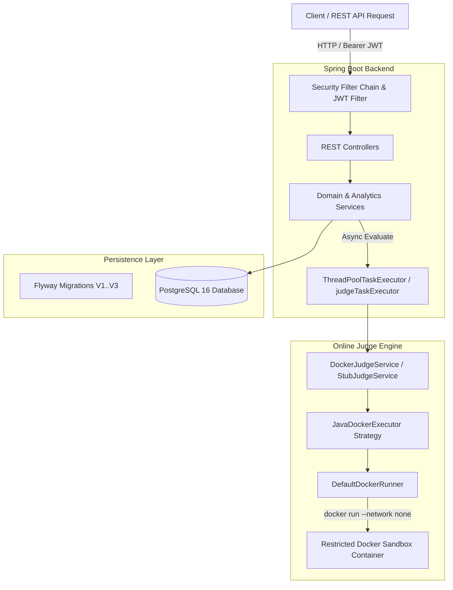
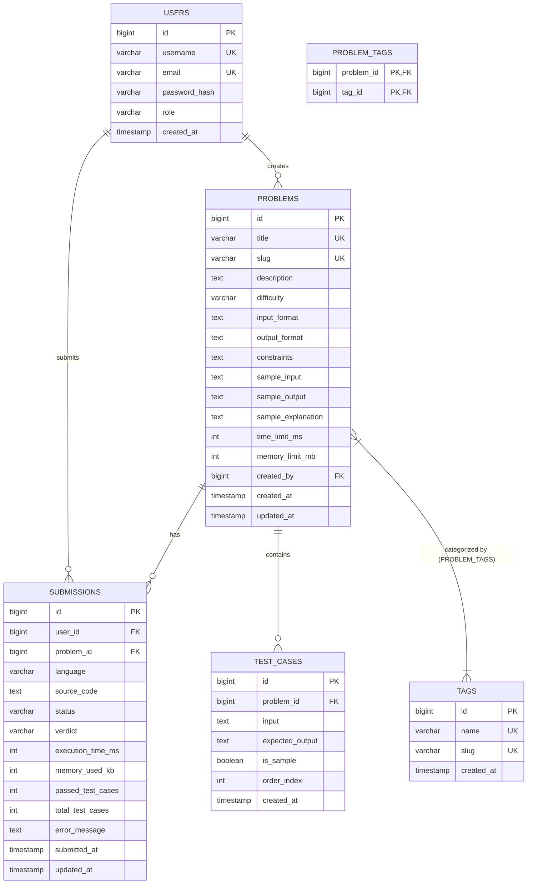

# Project Apricorn — Production-Grade Online Judge Backend

[]()
[]()
[]()
[]()
[]()

Project Apricorn is a production-inspired, highly secure Online Judge backend API built with Java 21 LTS, Spring Boot 3.3.5, PostgreSQL 16, Flyway migrations, and a containerized Docker judge sandbox.

---

## 🌟 Key Features

- **Stateless Authentication & RBAC**: JWT bearer token authentication with role-based access control (`ROLE_USER`, `ROLE_ADMIN`) and BCrypt password hashing.
- **Problem Management**: Full CRUD for coding problems with title, slug, difficulty, constraints, tags, sample cases, and hidden test-case isolation.
- **Secure Docker-Based Judge Engine**: Isolated execution of untrusted Java code inside restricted Docker containers with `--network none`, CPU/Memory limits, and process caps.
- **Asynchronous Execution Pipeline**: Bounded `ThreadPoolTaskExecutor` processing queue returning `202 Accepted` immediately.
- **Analytics & User Dashboard**: UTC calendar coding streak calculation (`currentStreak`, `longestStreak`), distinct solved problem counts, difficulty breakdowns, and recent activity.
- **Global Leaderboard & Rank Lookup**: Paginated competitive leaderboard ranked deterministically by solved count, hard solved count, medium solved count, acceptance rate, and username.
- **Platform Analytics**: Admin-only platform overview providing active daily user metrics, submission volumes, and language/verdict distributions.

---

## 🏗️ System Architecture



---

## 💻 Technology Stack

- **Core Framework**: Spring Boot 3.3.5, Java 21 LTS
- **Persistence**: Spring Data JPA, Hibernate, PostgreSQL 16, Flyway
- **Security**: Spring Security 6, JJWT (HMAC SHA-256), BCrypt
- **Sandbox Containerization**: Docker (`eclipse-temurin:21-jdk` runtime)
- **API Documentation**: OpenAPI 3.0 / Springdoc Swagger UI
- **Testing & Coverage**: JUnit 5, Mockito, Spring Security Test, JaCoCo

---

## 🛡️ Online Judge Security & Sandbox Controls

Untrusted code submitted by users is NEVER executed directly on the host machine or inside the Spring Boot JVM. Execution takes place exclusively within restricted Docker containers:

| Security Threat | Mitigation Control | Mechanism |
|---|---|---|
| Arbitrary Host Access | Docker Sandbox | Code runs inside container volume mounted strictly to a single workspace `/app`. |
| Outbound Exfiltration | Network Isolation | Container launched with `--network none`. |
| CPU Exhaustion / Loops | Resource Limit | `--cpus 0.5` + strict process execution timeout (`timeLimitMs`). |
| Memory Exhaustion | Memory Limit | `--memory 256m` and `--memory-swap 256m`. |
| Process Multiplication / Fork Bombs | PID Cap | `--pids-limit 64`. |
| Privilege Escalation | Capability Drop | `--cap-drop ALL` and `--security-opt no-new-privileges`. |
| Secret Test Leakage | Test Case Isolation | Hidden judge test inputs/outputs are never returned in API responses or public logs. |

---

## 📊 Database Design (Entity-Relationship Diagram)



---

## 🚀 Getting Started

### Prerequisites

- Java 21 LTS
- Maven 3.9+
- Docker & Docker Compose

### 1. Launch PostgreSQL Container

```bash
docker compose up -d
```

### 2. Configure Environment Variables

Copy `.env.example` to set local credentials:
```bash
export JWT_SECRET="your-super-secret-key-at-least-32-bytes-long"
export JUDGE_MODE="stub" # Set to "docker" for container evaluation
```

### 3. Run Application

```bash
cd backend
mvn spring-boot:run
```

### 4. Interactive API Documentation

Access Swagger UI in browser:
- `http://localhost:8080/swagger-ui.html`
- `http://localhost:8080/api-docs`

---

## 🧪 Testing & Code Coverage

Run the complete 90-test automated test suite:

```bash
cd backend
mvn clean test
```

Generate JaCoCo code coverage report:
```bash
mvn clean package
# Open target/site/jacoco/index.html in browser
```

Executable production JAR generated at:
`backend/target/apricorn-backend-0.0.1-SNAPSHOT.jar`

---

## 📐 Engineering Decisions & Trade-offs

1. **Distinct Problem Solved Definition**: A problem counts as solved when at least one `ACCEPTED` submission exists for the user. Multiple accepted solutions for the same problem count as **one** solved problem.
2. **Strategy Pattern Decoupling**: Language execution (`LanguageExecutor`) and container process runner (`DockerRunner`) are cleanly decoupled to allow effortless addition of future runtime engines.
3. **Database-Side Aggregation**: Leaderboard rankings, problem stats, and difficulty breakdowns execute via database-side aggregate queries (`COUNT DISTINCT`, `GROUP BY`) to prevent N+1 queries and memory bloat.

---

## 📑 Detailed Documentation

- [Submissions Module Documentation](docs/submissions.md)
- [Judge Architecture Specification](docs/judge.md)
- [Judge Security Threat Model](docs/judge-security.md)
- [Analytics & Leaderboard Specification](docs/analytics.md)
- [Admin Account Setup Guide](docs/admin-setup.md)
- [Architecture & ER Diagrams](docs/architecture.md)

---

## 📝 License

Distributed under the MIT License. See `LICENSE` for more information.
