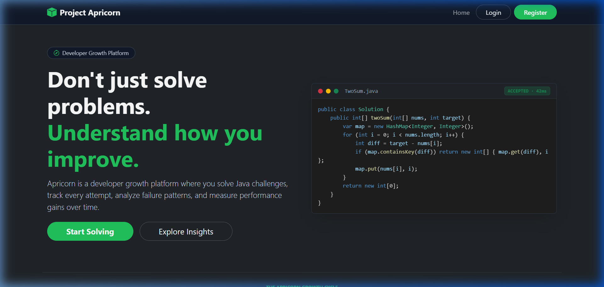
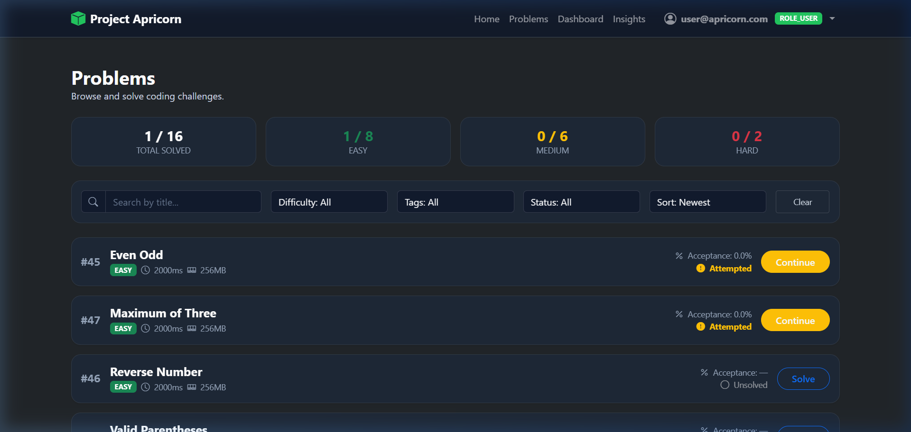
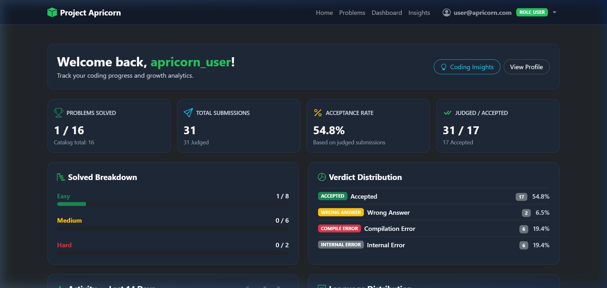
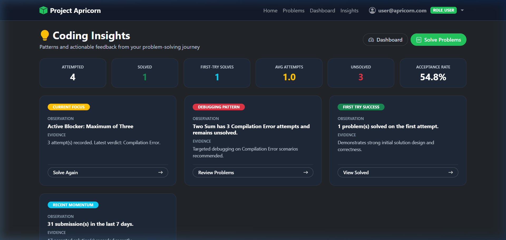
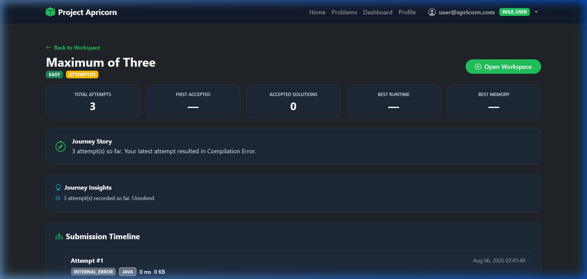
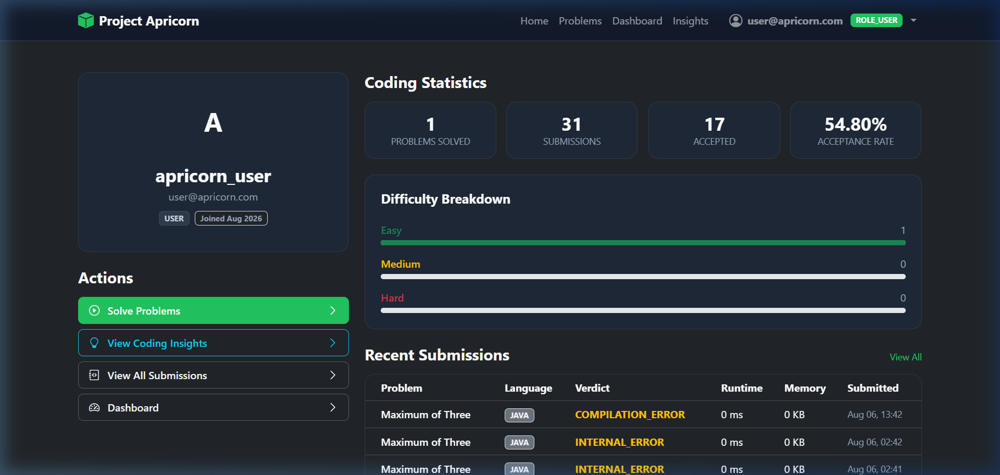

# Project Apricorn

### A Developer Growth Platform Built Around How You Solve, Not Just Whether You Solve.

[]()
[]()
[]()
[]()
[]()
[]()
[]()

Apricorn is a Java-powered developer growth platform that combines Docker-isolated code judging with Solution Journey, deterministic coding insights, and progress analytics.

Traditional online judges primarily answer:
> *"Did your solution pass?"*

Apricorn additionally asks:
> *"How did you solve it?"*  
> *"Where did you struggle?"*  
> *"How did your solution improve?"*  
> *"What should you work on next?"*

---

## 🔄 The Apricorn Growth Loop

```text
  ┌──────────┐     ┌──────────┐     ┌─────────────┐     ┌──────────┐
  │  SOLVE   │ ──► │  SUBMIT  │ ──► │ UNDERSTAND  │ ──► │ IMPROVE  │
  └──────────┘     └──────────┘     └─────────────┘     └──────────┘
```

1. **SOLVE**
   - Browse 15 canonical programming challenges with tag, difficulty, and status filters.
   - Receive function-based starter code for clean algorithmic implementations.
   - Focus purely on method logic without `Scanner` or `System.in` boilerplate.
2. **SUBMIT**
   - Submit `Solution` class logic to an asynchronous judging queue returning `202 Accepted` immediately.
   - Compilation and structured test evaluation run inside an isolated Docker container sandbox.
   - Enforces strict memory caps (256MB), CPU allocation (0.5 cores), and network isolation (`--network none`).
3. **UNDERSTAND**
   - Inspect immediate testcase pass counts, runtime execution speed, and memory usage.
   - Review your **Solution Journey** timeline tracking chronological attempts from initial failure to accepted milestones.
   - Compare personal best runtime and memory benchmarks against your own solving history.
4. **IMPROVE**
   - Consult your **Deterministic Solution Insights** engine to discover active blockers, failure patterns, and breakthrough solves.
   - Track your 14-day activity trends and verdict distributions on the **Growth Dashboard**.
   - Receive tailored continue-solving recommendations to target skill gaps effectively.

---

## 💡 Why Apricorn?

Apricorn explores a different layer of the coding-practice experience: **understanding the developer's solving process over time**.

Instead of discarding past failed attempts or treating code submissions as transient binary pass/fail events, Apricorn treats **attempt history as a first-class domain object**.

- **First-Class Attempt Timeline**: Tracks how your code evolves across multiple submissions.
- **Solution Journey**: Automatically identifies your first accepted attempt, best runtime performance, and best memory usage.
- **100% Deterministic Insights**: Analyzes submission history deterministically to highlight repeated error types and breakthrough iterations without external AI dependencies or hallucination risks.
- **Function-Based Judge Contract**: Eliminates input parsing friction by passing structured JSON parameters directly into your method parameters.

---

## ✨ Key Features

| Feature | Description | Status |
|---|---|---|
| **Docker-Isolated Sandbox** | Untrusted user Java code executes inside restricted Docker containers (`--network none`, 256MB RAM limit, 0.5 CPU ceiling). | **Verified (V1)** |
| **Function-Based Contract** | Users write algorithmic `Solution` method logic. Harness wrapper handles deserialization and result output. | **Verified (V1)** |
| **Structured Test Cases** | Server-side testcase execution passing JSON parameters into strongly typed method signatures. | **Verified (V1)** |
| **Solution Journey** | Chronological timeline of attempts per problem detailing first acceptance, runtime improvements, and code diffs. | **Verified (V1)** |
| **Deterministic Insights** | Zero-latency, zero-cost analysis identifying failure patterns, active blockers, and breakthrough submissions. | **Verified (V1)** |
| **Growth Dashboard** | Problem-solving metrics including solved count, acceptance rate, 14-day activity chart, and difficulty progress. | **Verified (V1)** |
| **Problem Discovery** | Filter canonical catalog by search keyword, difficulty (`EASY`, `MEDIUM`, `HARD`), tag, and user solve status. | **Verified (V1)** |
| **JWT Authentication** | Stateless security using HttpOnly cookies for web UI and Bearer tokens for REST API requests. | **Verified (V1)** |
| **User Data Isolation** | Server-side security checks ensuring users cannot view or mutate another user's private submissions or insights. | **Verified (V1)** |
| **PostgreSQL + Flyway** | Schema versioning (`V1` through `V12`) managing user accounts, problem metadata, testcases, and submissions. | **Verified (V1)** |
| **Testcontainers Test Suite** | 120 automated tests running against Testcontainers PostgreSQL and real Docker sandbox execution. | **Verified (V1)** |
| **Responsive Web UI** | Modern Thymeleaf + Vanilla CSS web interface optimized for desktop, tablet, and mobile browsers. | **Verified (V1)** |

---

## ⚡ How the Judge Works

```text
User Solution Code
       │
       ▼
POST /api/v1/problems/{slug}/submissions
       │
       ▼
Save PENDING → 202 Accepted Response
       │
       ▼ (Async SubmissionEventListener)
Generate Java Harness (Main.java wrapper)
       │
       ▼
Launch Docker Sandbox (eclipse-temurin:21-jdk)
  ├── --network none
  ├── --memory 256m
  ├── --cpus 0.5
  └── --rm (auto-cleanup)
       │
       ▼
Compile (javac Main.java Solution.java)
       │
       ▼
Execute Structured Test Cases
  ├── Invoke Solution.methodName(args...)
  └── Write returned object to result.out as JSON
       │
       ▼
Typed Output Comparison (Spring Boot server side)
       │
       ▼
Save Verdict (ACCEPTED / WRONG_ANSWER / RUNTIME_ERROR / TLE / CE)
```

### Docker Execution Security Boundary
Native kernel namespaces and cgroups provide strict container isolation:
- **Network Isolation**: `--network none` blocks outbound socket connections, HTTP requests, or exfiltration.
- **Resource Caps**: Capped at `256m` RAM and `0.5` CPU core to prevent resource exhaustion or infinite loop starvation.
- **Auto Cleanup**: Ephemeral containers are removed upon exit (`--rm`), and temporary host workspaces are deleted in a `finally` block.

---

## 🧩 Function-Based Submission Model

Rather than implementing `public static void main(String[] args)` and reading standard input via `Scanner`, users write clean, method-focused algorithmic code:

```java
class Solution {
    public int[] twoSum(int[] nums, int target) {
        Map<Integer, Integer> map = new HashMap<>();
        for (int i = 0; i < nums.length; i++) {
            int complement = target - nums[i];
            if (map.containsKey(complement)) {
                return new int[] { map.get(complement), i };
            }
            map.put(nums[i], i);
        }
        return new int[0];
    }
}
```

### Advantages
- **Clean Developer Experience**: Focus strictly on algorithm design without IO parsing overhead.
- **Server-Controlled Inputs**: Testcase values are injected safely via canonical JSON serialization.
- **Type Safety**: Parameters and return values are verified against problem signatures.

### Supported V1 Java Types
`int`, `long`, `boolean`, `String`, `int[]`, `String[]`, `int[][]`

---

## 🔒 Diagnostic Stdout vs Judge Result Channel

To ensure ordinary debugging (`System.out.println("debug log")`) does not corrupt return evaluation:
- User `System.out.println` output is captured strictly as diagnostic logging.
- The returned value from `Solution` method execution is serialized into a separate `result.out` file as canonical JSON.
- `OutputComparator` evaluates `result.out` against the target `expectedOutput` using typed JSON equality on the trusted Spring Boot host process.

---

## ⚖️ Verdict Definitions

| Verdict | Meaning |
|---|---|
| **`ACCEPTED`** | Code compiled and produced expected return values for 100% of hidden test cases within execution limits. |
| **`WRONG_ANSWER`** | Code compiled, but returned output diverged from expected output on one or more test cases. |
| **`COMPILATION_ERROR`** | `javac` returned a non-zero exit code. Raw compiler output is saved for user inspection. |
| **`RUNTIME_ERROR`** | An unhandled JVM exception occurred during method execution (e.g. `ArrayIndexOutOfBoundsException`). |
| **`TIME_LIMIT_EXCEEDED`** | Execution time exceeded the configured per-problem time limit (`timeLimitMs`). |
| **`INTERNAL_ERROR`** | Infrastructure failure (e.g. Docker daemon error or missing testcases). Excluded from user failure metrics. |

---

## 📜 Solution Journey

The **Solution Journey** page aggregates every attempt submitted for a specific problem into a chronological narrative:

```text
Attempt 1 (WRONG_ANSWER)  ──►  Attempt 2 (COMPILATION_ERROR)  ──►  Attempt 3 (ACCEPTED ⭐ First Accepted)
                                                                            │
                                                                            ▼
                                                                  Attempt 4 (ACCEPTED ⚡ Best Runtime: 485ms)
```

- **Attempt Index**: View exact code diffs and error messages across attempts.
- **Milestones**: Highlights **First Accepted**, **Personal Best Runtime**, and **Personal Best Memory**.
- **Performance Progression**: Quantifies runtime and memory percentage improvements over your initial accepted solution.

---

## 🧠 Deterministic Solution Insights

*Apricorn does not call external LLM APIs to generate insights.*

All insights are calculated deterministically by evaluating database submission history:
- **Failure Patterns**: Detects recurring syntax, logic, or runtime error trends across recent submissions.
- **Active Blockers**: Identifies problems with multiple failing attempts requiring focus.
- **Breakthrough Solve Detection**: Highlights problems where multiple failed attempts culminated in an accepted solution.
- **7-Day Submission Momentum**: Tracks daily solving activity and progress trends.

---

## 📊 Growth Dashboard

The **Growth Dashboard** aggregates user activity into actionable analytics:
- **Total Solved & Submissions**: Solved count derived strictly from distinct accepted problems.
- **Acceptance Rate**: Percentage of accepted submissions relative to total judged attempts.
- **Difficulty Progress Bar**: Visual breakdown across `EASY`, `MEDIUM`, and `HARD` problems.
- **14-Day Activity Chart**: Chronological daily submission volume tracking.
- **Continue Solving Recommendations**: Contextual recommendations guiding users back to uncompleted problems.

---

## 🛡️ Security & Access Control

- **Stateless Authentication**: JWT tokens stored in HttpOnly cookies (`jwt_token`).
- **Password Security**: Hashed via BCrypt with standard cost factor.
- **Cross-User Data Isolation**: REST endpoints enforce ownership checks (`userId == principal.id`), preventing unauthorized access to private submissions or user analytics.
- **Secret Secret Enforcement**: Application startup aborts if `JWT_SECRET` is unconfigured or less than 32 characters long.

---

## 🏛️ System Architecture Diagram

```mermaid
graph TD
    Client["Client Browser (Monaco Editor & UI)"]
    
    subgraph Spring Boot Backend
        Security["Spring Security & JWT Filter"]
        WebCtrl["Web Controllers (Thymeleaf Pages)"]
        RestCtrl["REST Controllers (JSON APIs)"]
        
        subgraph Domain Services
            ProblemSvc["Problem Service"]
            SubSvc["Submission Service"]
            AnalyticsSvc["Analytics Service"]
            JourneySvc["Solution Journey Service"]
            InsightsSvc["Solution Insights Service"]
            JudgeSvc["Async Judge Service"]
        end
    end
    
    subgraph Persistence Layer
        DB[("PostgreSQL 16 (Flyway V1-V12)")]
    end
    
    subgraph Execution Infrastructure
        HarnessGen["Java Harness Generator"]
        DockerExec["Java Docker Executor"]
        DockerContainer["Isolated Docker Container (--network none, 256MB RAM)"]
    end

    Client -->|HTTP / JWT Cookie| Security
    Security --> WebCtrl
    Security --> RestCtrl
    
    WebCtrl --> Domain Services
    RestCtrl --> Domain Services
    
    Domain Services --> DB
    SubSvc -->|Publish SubmissionCreatedEvent| JudgeSvc
    
    JudgeSvc --> HarnessGen
    JudgeSvc --> DockerExec
    DockerExec -->|docker run| DockerContainer
```

---

## 🛠️ Technology Stack

| Layer | Technologies |
|---|---|
| **Backend Framework** | Java 21 LTS, Spring Boot 3.3.5 |
| **Security** | Spring Security 6, JJWT (HMAC SHA-256), BCrypt |
| **Persistence** | PostgreSQL 16, Spring Data JPA, Hibernate, Flyway Migrations (V1–V12) |
| **Code Execution** | Docker Engine (`eclipse-temurin:21-jdk`) |
| **Frontend** | Thymeleaf, Bootstrap 5, Vanilla CSS, Vanilla JavaScript, Monaco Editor |
| **Testing** | JUnit 5, Spring Boot Test, Testcontainers PostgreSQL, Mockito |
| **Build & Observability** | Maven Wrapper (`./mvnw`), Spring Boot Actuator |

---

## 📁 Project Structure

```text
com.apricorn
├── analytics          # Growth Dashboard analytics & aggregated metrics
├── auth               # User authentication controllers & DTOs
├── common             # Global exceptions, web error handlers & utilities
├── config             # Spring Security, Async, & MVC configurations
├── insights           # Deterministic solution insights engine
├── journey            # Solution Journey timeline & performance service
├── judge              # Code judging pipeline, harness generator & Docker executor
├── problem            # Problem catalog specifications, search & filtering
├── security           # JWT service, security filters & UserPrincipal details
├── submission         # Code submission models, repositories & event listeners
├── user               # User account entity & profile management
└── web                # Thymeleaf page view controllers
```

---

## 🚀 Quick Start (Local Setup)

### Prerequisites
- **Java 21 LTS** (`java -version`)
- **Docker Engine** (`docker --version`)
- **Git**

### 1. Start PostgreSQL Container
```bash
docker compose up -d
```

### 2. Configure Environment Variables
Set required secret key and profile:
```bash
# Windows PowerShell
$env:JWT_SECRET="SuperSecretLocalDevSigningKeyWhichIsAtLeast32CharsLong!"
$env:SPRING_PROFILES_ACTIVE="dev"

# Linux / macOS
export JWT_SECRET="SuperSecretLocalDevSigningKeyWhichIsAtLeast32CharsLong!"
export SPRING_PROFILES_ACTIVE="dev"
```

### 3. Launch Application
```bash
cd backend
# Windows
.\mvnw.cmd spring-boot:run

# Linux / macOS
./mvnw spring-boot:run
```

Access the application in your browser at `http://localhost:8080`.

---

## 🐳 Production Build & Docker Image

### Build Executable JAR
```bash
cd backend
./mvnw clean package
```
Output artifact: `target/apricorn-backend-0.0.1-SNAPSHOT.jar`

### Build Docker Image
```bash
cd backend
docker build -t apricorn-backend:1.0.0 .
```

*Note: The host machine executing the Spring Boot backend MUST have access to a local Docker daemon because submitted code is evaluated inside ephemeral Docker runner containers.*

---

## 🧪 Testing

Project Apricorn includes a comprehensive 120-test automated verification suite covering unit tests, controller slice tests, security authorization checks, Flyway schema migrations, and real Docker judge execution:

```bash
cd backend
# Set DOCKER_AVAILABLE=true to enable container execution tests
$env:DOCKER_AVAILABLE="true"
.\mvnw.cmd clean test
```

### Test Verification Summary
- **Tests run**: 120
- **Failures**: 0
- **Errors**: 0
- **Skipped**: 0

---

## 🖼️ Application Screenshots

| Page | Preview |
|---|---|
| **Home Page** |  |
| **Problems Catalog** |  |
| **Growth Dashboard** |  |
| **Solution Insights** |  |
| **Solution Journey** |  |
| **User Profile** |  |

---

## 📑 Technical Documentation

- [Deployment Guide](backend/docs/DEPLOYMENT.md)
- [Architecture Specification](backend/docs/architecture.md)
- [Judge Pipeline Specification](backend/docs/judge-pipeline.md)
- [Security & Sandbox Specification](backend/docs/security.md)
- [Data & Domain Model Specification](backend/docs/data-model.md)
- [Engineering Decisions (ADRs)](backend/docs/engineering-decisions.md)

---

## 📐 Major Engineering Decisions (ADRs)

1. **Java 21 & Spring Boot 3.3.5**: Native virtual thread compatibility, modern JPA features, and robust enterprise framework support.
2. **PostgreSQL 16 & Flyway Migrations**: Strict transactional relational persistence managed by Flyway migrations (`V1` through `V12`).
3. **Docker Execution Sandbox**: Native kernel container isolation using ephemeral containers (`--network none`, `256m` memory limit, `0.5` CPU allocation).
4. **Asynchronous Judging Pipeline**: Non-blocking `POST` API returning `202 Accepted` immediately while judging executes asynchronously via `@Async` event dispatch.
5. **Deterministic Solution Insights**: 100% explainable, zero-cost, zero-latency feedback derived strictly from stored database records without external LLM risks.
6. **Testcontainers Integration Testing**: Isolated PostgreSQL container execution during integration testing prevents development database pollution.

---

## 🚧 V1 Architecture Boundaries

To ensure maximum stability for V1.0, the following scope boundaries were established intentionally:
- **Function-Based Java Only**: V1 supports single-function Java contracts.
- **Constrained V1 Types**: Supported parameters/returns limited to primitive/array structures (`int`, `long`, `boolean`, `String`, `int[]`, `String[]`, `int[][]`).
- **Single-Node Judging**: V1 runs Spring Boot host process with local Docker engine daemon integration.
- **In-Memory Event Queue**: Async submission events are dispatched in-memory via Spring `@Async`.

---

## 🔮 Future Roadmap (Post-V1)

*The following features are planned for future iterations and are NOT included in V1.0:*
- Distributed submission queue backed by Redis or RabbitMQ.
- Multi-instance container worker node scaling.
- Extended function contract support (e.g. `ListNode`, `TreeNode`, multi-class designs).
- Additional programming language runtimes (Python, C++).

---

## 🤝 Contributing

1. Fork the repository.
2. Create your feature branch (`git checkout -b feature/AmazingFeature`).
3. Run full test suite (`.\mvnw.cmd clean test`).
4. Commit your changes (`git commit -m 'Add some AmazingFeature'`).
5. Push to the branch (`git push origin feature/AmazingFeature`).
6. Open a Pull Request.

---

## 📄 License

Distributed under the MIT License. See `LICENSE` for details.

---

## 👤 Author & Credits

**Project Apricorn** was designed and implemented by [Saransh](https://github.com/saransh9822).
