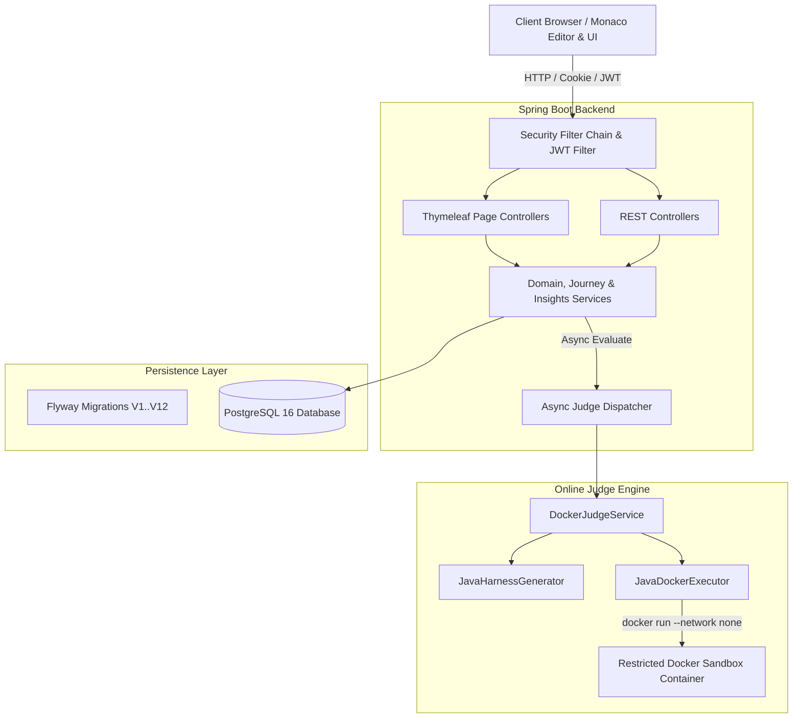
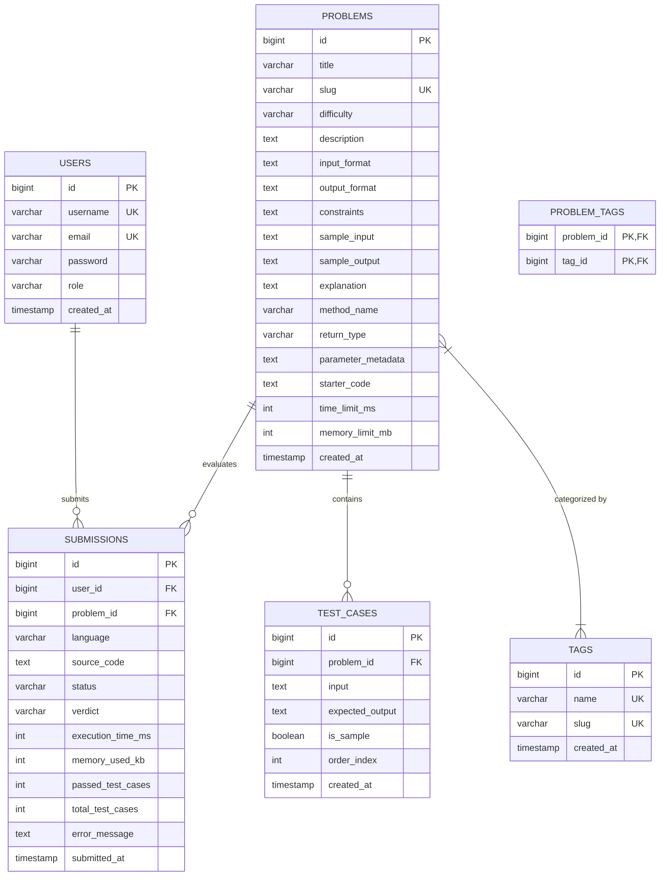

# Project Apricorn — Production-Grade Online Judge Backend

[]()
[]()
[]()
[]()
[]()

Project Apricorn is a developer growth platform that combines Docker-isolated Java code judging with a function-based submission model, chronological Solution Journey tracking, deterministic Solution Insights, and comprehensive progress analytics.

---

## 🌟 Key Features

- **Function-Based Java Judge Contract**: Users write algorithmic method logic (`Solution` class). Stdin/stdout boilerplate, parsing, and execution are handled cleanly by generated harnesses and structured JSON testcases.
- **Solution Journey**: Chronological attempt timelines tracking progress from initial failure through accepted attempts to runtime and memory optimization personal bests.
- **Deterministic Solution Insights**: Zero-latency, zero-cost, explainable feedback analyzing failure patterns, active blockers, breakthrough attempts, and weekly coding momentum without external AI hallucination risks.
- **Developer Growth Dashboard**: Comprehensive progress tracking with difficulty breakdowns, acceptance rates, 14-day activity charts, verdict/language distributions, and continue-solving recommendations.
- **Secure Docker-Based Sandbox**: Untrusted user code compiles and executes inside ephemeral Docker containers under strict network isolation (`--network none`), CPU/memory limits, and process caps.
- **Stateless Auth & RBAC**: JWT authentication with role-based authorization (`USER`, `ADMIN`), BCrypt password hashing, and complete cross-user data isolation.

---

## 🏗️ System Architecture



---

## 💻 Technology Stack

- **Core Framework**: Spring Boot 3.3.5, Java 21 LTS
- **Persistence**: Spring Data JPA, Hibernate, PostgreSQL 16, Flyway (Migrations V1–V12)
- **Security**: Spring Security 6, JJWT (HMAC SHA-256), BCrypt
- **Sandbox Containerization**: Docker Engine (`eclipse-temurin:21-jdk`)
- **Testing & Integration**: JUnit 5, Testcontainers PostgreSQL, Mockito, Spring Security Test

---

## 📊 Database Design (Entity-Relationship Diagram)



---

## 🚀 Getting Started

### Prerequisites

- Java 21 LTS
- Docker Desktop or Docker Engine
- Git

### 1. Launch PostgreSQL Container

```bash
docker compose up -d
```

### 2. Run Application

```bash
cd backend
export JWT_SECRET="SuperSecretLocalDevSigningKeyWhichIsAtLeast32CharsLong!"
export SPRING_PROFILES_ACTIVE="dev"
./mvnw spring-boot:run
```

---

## 🧪 Testing & Verification

Run the full 120-test automated verification suite with Docker enabled:

```bash
cd backend
$env:DOCKER_AVAILABLE="true" # PowerShell or export DOCKER_AVAILABLE=true in Bash
./mvnw clean test
```

Build production executable JAR:
```bash
./mvnw clean package
```

Build production Docker image:
```bash
docker build -t apricorn-backend:1.0.0 .
```

---

## 📑 Detailed Architecture Documentation

- [Deployment Guide](docs/DEPLOYMENT.md)
- [Architecture Specification](docs/architecture.md)
- [Judge Pipeline Specification](docs/judge-pipeline.md)
- [Security & Sandbox Specification](docs/security.md)
- [Data & Domain Model Specification](docs/data-model.md)
- [Engineering Decisions (ADRs)](docs/engineering-decisions.md)

---

## 📝 License

Distributed under the MIT License. See `LICENSE` for more information.
