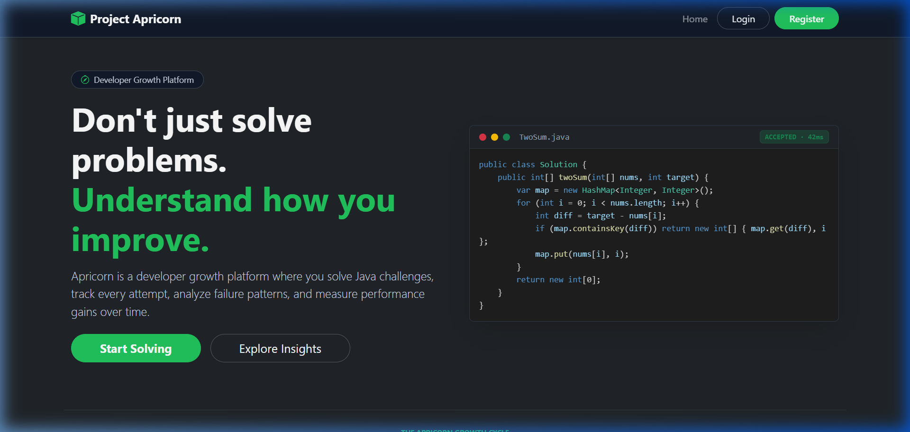
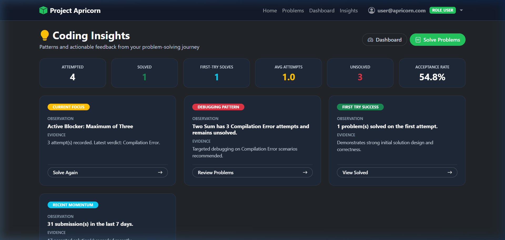
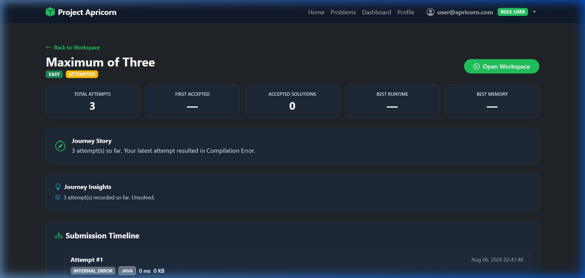
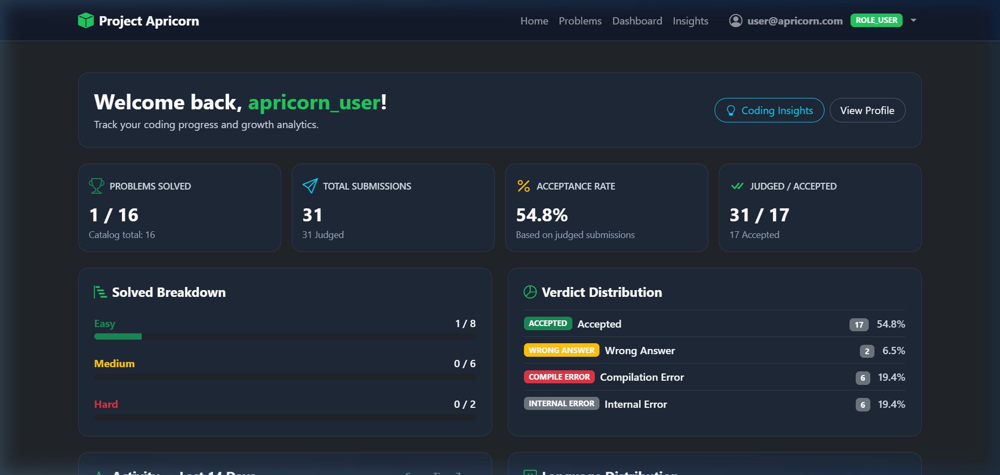
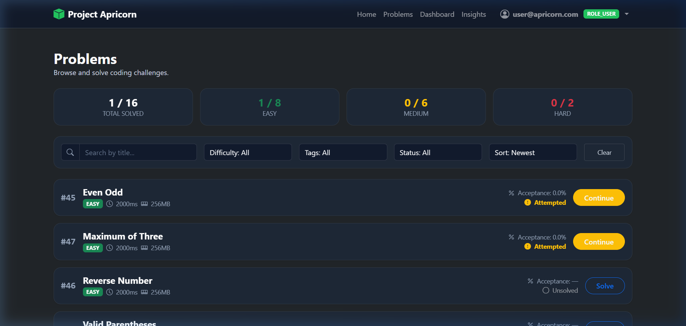
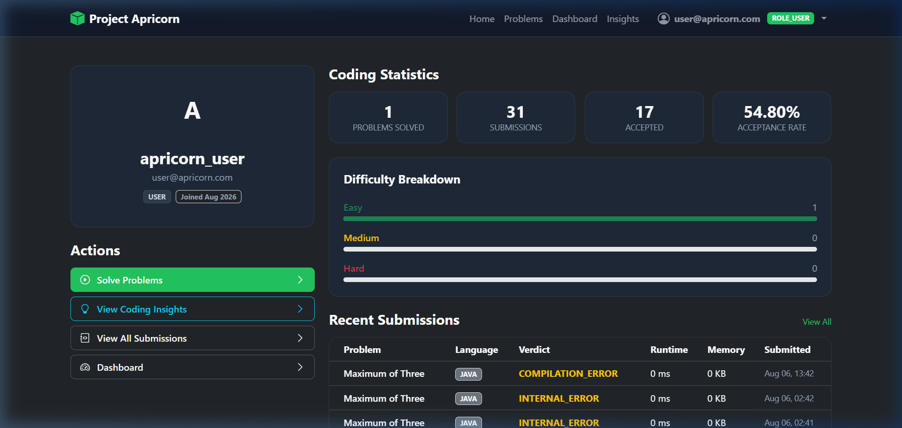

# Project Apricorn

A Java-powered developer growth platform that combines Docker-isolated code judging with solution journeys, deterministic coding insights, and progress analytics.


---

## 🌟 Why Apricorn Exists

Traditional online coding platforms primarily focus on a single transaction:

$$\text{Problem} \longrightarrow \text{Submission} \longrightarrow \text{Verdict}$$

**Project Apricorn** extends this lifecycle into a continuous developer growth model:

$$\text{Problem} \longrightarrow \text{Attempts} \longrightarrow \text{Verdict History} \longrightarrow \text{Solution Journey} \longrightarrow \text{Pattern Analysis} \longrightarrow \text{Improvement}$$

Apricorn preserves your complete attempt progression and turns raw execution data into actionable insights, showing you **how** you improve over time.

---

## 🔄 The Apricorn Growth Loop

```text
┌─────────────────────────────────────────────────────────────┐
│                          SOLVE                              │
│       Browser workspace with Monaco Editor & Java 21        │
└──────────────────────────────┬──────────────────────────────┘
                               │
                               ▼
┌─────────────────────────────────────────────────────────────┐
│                         SUBMIT                              │
│       Docker-isolated execution with real metrics           │
└──────────────────────────────┬──────────────────────────────┘
                               │
                               ▼
┌─────────────────────────────────────────────────────────────┐
│                        UNDERSTAND                           │
│       Chronological Solution Journey & milestone badges     │
└──────────────────────────────┬──────────────────────────────┘
                               │
                               ▼
┌─────────────────────────────────────────────────────────────┐
│                         IMPROVE                             │
│       Deterministic insights targeting failure patterns     │
└─────────────────────────────────────────────────────────────┘
```

---

## 🚀 Core Differentiators

### 1. 🐳 Real Docker-Isolated Judge Engine
- **Isolated Execution**: User submissions compile (`javac`) and execute (`java`) inside dedicated Docker runner containers (`eclipse-temurin:21-jdk`).
- **Resource Constraints**: Capped at 256MB RAM (`--memory 256m`), 0.5 CPU core (`--cpus 0.5`), and strict execution timeouts.
- **Network Isolation**: Enforces `--network none` to block socket connections and external network access.
- **Accurate Feedback**: Returns real test-case pass/fail counts, execution time (ms), and memory usage (KB).

### 2. 🗺️ Solution Journey
- **Chronological Attempt History**: Tracks every submission for a problem from initial failure to first acceptance and subsequent optimizations.
- **Milestone Badges**: Automatically highlights `First Accepted`, `Personal Best — Runtime`, and `Personal Best — Memory` attempts.
- **Diff & Source Inspection**: View exact source code and error output for any past attempt.

### 3. 💡 Deterministic Solution Insights
- **100% Database-Derived**: Computes actionable insights directly from submission history without external LLM or AI dependencies.
- **Explainable Feedback**: Analyzes compilation error frequency, repeated wrong answers, persistence patterns, and active blockers.
- **Structured Format**: Every insight card provides an **Observation → Evidence → Action** layout.

### 4. 📊 Growth Dashboard (Analytics Engine 2.0)
- **Command Center**: Actionable dashboard prioritizing *"What should I do next?"*.
- **Live Metrics**: Solved counts, acceptance rates, difficulty breakdowns, verdict distributions, and active attempted-unsolved blockers.

---

## 📸 Screenshot Gallery

### 1. Developer Growth Homepage


### 2. Solution Insights


### 3. Solution Journey Timeline


### 4. Growth Dashboard


### 5. Problem Catalogue & Filters


### 6. User Profile


---

## ⚙️ Tech Stack & Architecture

| Category | Technology |
|---|---|
| **Core Language** | Java 21 LTS |
| **Framework** | Spring Boot 3.3.5 |
| **Security** | Spring Security, JWT (HMAC-SHA256), HttpOnly Cookies, BCrypt |
| **Database** | PostgreSQL 16 |
| **Schema Migrations** | Flyway (`V1` through `V12`) |
| **Execution Engine** | Docker Engine (`eclipse-temurin:21-jdk`) |
| **Frontend** | Thymeleaf, Bootstrap 5, Monaco Editor, Vanilla JavaScript |
| **Testing** | JUnit 5, Spring Boot Test, Testcontainers PostgreSQL |
| **Build & Tooling** | Maven Wrapper (`./mvnw`) |

---

## 📂 Repository Package Structure

```text
com.apricorn
├── analytics          # Growth Dashboard & Analytics Engine 2.0
├── auth               # User authentication & registration logic
├── exception          # Global exception handlers & custom errors
├── insights           # Deterministic Solution Insights engine
├── journey            # Solution Journey timeline & milestone service
├── judge              # Docker-based asynchronous code judge
├── problem            # Problem catalog, search, tags, & progress
├── security           # Spring Security, JWT filters, & UserPrincipal
├── submission         # Submission persistence, lifecycle, & history
├── user               # User account entity & profile management
└── web                # Page controllers & web routing
```

---

## 🛠️ Local Development Setup

### Prerequisites
- **Java 21 LTS** (`java -version`)
- **Docker Desktop / Docker Engine** (running locally)
- **PostgreSQL 16+** (running locally on port 5432)

### Setup Steps

1. **Clone the Repository**:
   ```bash
   git clone https://github.com/your-org/apricorn.git
   cd apricorn/backend
   ```

2. **Configure Environment Variables**:
   Copy `.env.example` to `.env` or set environment variables:
   ```bash
   export SPRING_PROFILES_ACTIVE=dev
   export DB_HOST=localhost
   export DB_PORT=5432
   export DB_NAME=apricorn
   export DB_USERNAME=apricorn
   export DB_PASSWORD=apricorn
   export JWT_SECRET=supersecretkey_for_testing_purposes_only_which_is_long_enough
   ```

3. **Run Database Migrations & Test Suite**:
   ```bash
   # On Linux/macOS:
   ./mvnw clean test

   # On Windows:
   .\mvnw.cmd clean test
   ```

4. **Start the Application**:
   ```bash
   # On Linux/macOS:
   ./mvnw spring-boot:run

   # On Windows:
   .\mvnw.cmd spring-boot:run
   ```
   Access the application in your browser at `http://localhost:8080`.

---

## 📚 Technical Specifications & Architecture Docs

- [System Architecture Specification](docs/architecture.md)
- [Judge Execution Pipeline Specification](docs/judge-pipeline.md)
- [Data Model & Analytical Derivation](docs/data-model.md)
- [Security & Sandbox Specification](docs/security.md)
- [Architecture Decision Records (ADRs)](docs/engineering-decisions.md)
- [Production Deployment Guide](docs/DEPLOYMENT.md)

---

## ⚖️ License

Project Apricorn is developed as an open-source developer growth platform demonstration. All rights reserved.
