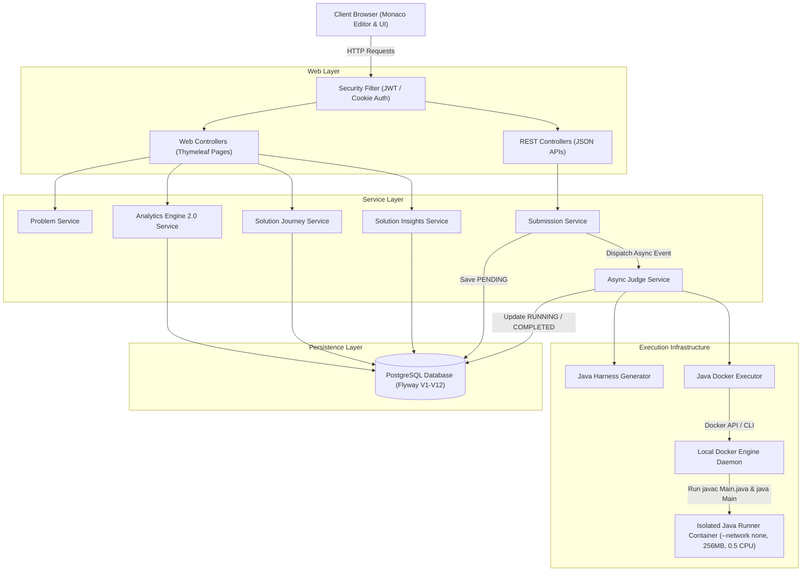

# Project Apricorn — System Architecture Specification

This document details the software architecture, component relationships, and execution boundaries of **Project Apricorn**.

---

## 1. System Architecture Diagram

---

## 2. Layer Responsibilities

### Web & Security Layer (`com.apricorn.web`, `com.apricorn.security`)
- Handles HTTP requests, Thymeleaf page rendering, and REST API serialization.
- Enforces stateless authentication via JWT tokens and HttpOnly cookies.
- Protects private user endpoints and isolates user-specific submission queries.

### Service Layer (`com.apricorn.*.service`)
- **Problem Service**: Manages problem catalog search, tag/difficulty filtering, and user progress summaries.
- **Submission Service**: Orchestrates code submission creation, validation, and user history retrieval.
- **Async Judge Service**: Handles asynchronous judging dispatch, container execution, and verdict persistence.
- **Analytics Engine 2.0**: Computes real-time problem-solving statistics, verdict distributions, and activity trends.
- **Solution Journey Service**: Generates chronological attempt timelines, milestone badges, and performance comparisons.
- **Solution Insights Service**: Executes deterministic analysis over submission history to identify failure patterns and active blockers.

### Persistence Layer (`com.apricorn.*.repository`, `com.apricorn.*.entity`)
- Managed by Spring Data JPA and Flyway schema migrations (`V1` through `V12`).
- Indexed for user-scoped queries and chronological timeline queries (`idx_submissions_user_problem_submitted_at`).

### Execution Infrastructure (`com.apricorn.judge.executor`)
- `JavaHarnessGenerator`: Constructs executable `Main.java` wrappers that parse structured testcase parameters, invoke user `Solution` methods, serialize returns to `result.out`, and sanitize user standard output.
- `JavaDockerExecutor`: Launches short-lived Docker containers (`eclipse-temurin:21-jdk`) for isolated code compilation and test-case execution under strict memory, CPU, and network constraints.
