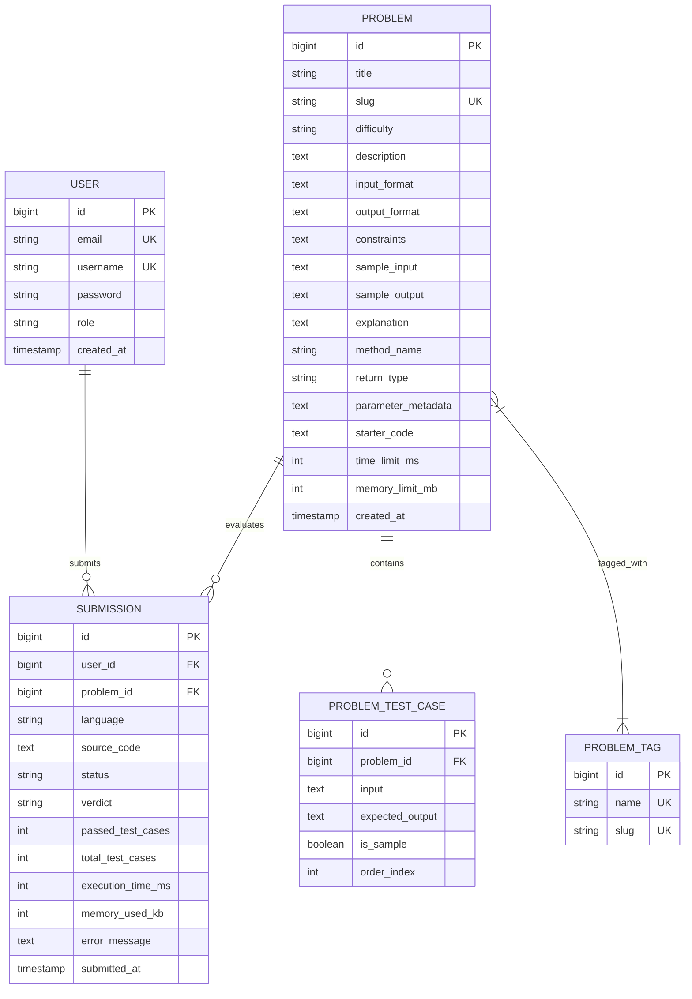

# Project Apricorn — Data & Domain Model Specification

This document describes the core domain entities, database relationships, and analytical derivation strategy in **Project Apricorn**.

---

## 1. Entity Relationship Diagram

---

## 2. Dynamic Analytical Derivation Strategy

To maintain database consistency and eliminate data synchronization bugs, Project Apricorn **never stores duplicated summary counters or static analytical snapshots**.

Instead, all user analytics, journeys, and insights are computed dynamically from immutable `Submission` records:

### A. Growth Dashboard Analytics (`AnalyticsService`)
- **Total Solved**: `COUNT(DISTINCT problem_id)` where `verdict = ACCEPTED` and `status = COMPLETED`.
- **Acceptance Rate**: `(ACCEPTED Submissions / Judged Submissions) * 100`.
- **Difficulty Breakdown**: Grouped count of distinct solved problems matching `EASY`, `MEDIUM`, and `HARD`.

### B. Solution Journey (`JourneyService`)
- Derived by querying user submissions for a specific problem ID sorted by `submittedAt ASC`.
- **Milestones**:
  - `First Accepted`: The earliest attempt index where `verdict = ACCEPTED`.
  - `Personal Best Runtime`: The accepted attempt with the minimum `executionTimeMs`.
  - `Personal Best Memory`: The accepted attempt with the minimum `memoryUsedKb`.

### C. Solution Insights (`InsightsService`)
- Derived deterministically by evaluating all attempted problem submission histories for the user.
- Identifies first-try solves, terminal failure pattern weaknesses, debugging persistence, active blockers, and 7-day submission momentum.
