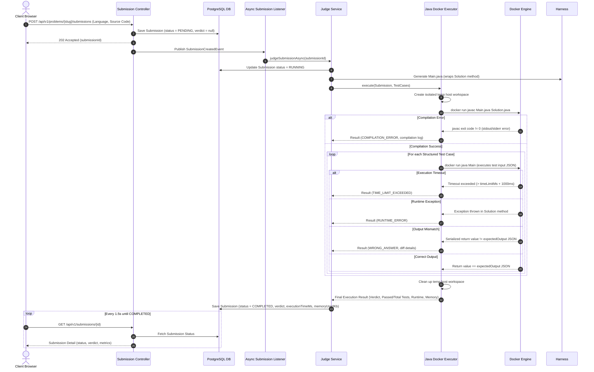

# Project Apricorn — Judge Pipeline Specification

This document details the real-time execution lifecycle of code submissions evaluated by **Project Apricorn**.

---

## 1. Submission Lifecycle Diagram

---

## 2. Verdict Definitions

- **`ACCEPTED`**: The code compiled successfully and produced exactly matching output for 100% of hidden test cases within memory and time constraints.
- **`WRONG_ANSWER`**: The code compiled and executed, but output diverged from expected output on one or more test cases. Detailed input, expected output, and actual output diffs are rendered to the owner.
- **`COMPILATION_ERROR`**: The Java compiler (`javac`) returned a non-zero exit code. Raw compiler output is captured and saved for user inspection.
- **`RUNTIME_ERROR`**: The Java virtual machine threw an unhandled exception (e.g. `ArrayIndexOutOfBoundsException`, `NullPointerException`). Exception trace snippets are preserved.
- **`TIME_LIMIT_EXCEEDED`**: Execution exceeded the configured per-problem time limit (`timeLimitMs`).
- **`INTERNAL_ERROR`**: Platform or system error (e.g. missing test cases in database or Docker daemon failure). This status is explicitly excluded from user failure metrics.

---

## 3. Safety & Zero-Test-Case Protection

1. **Empty Test-Case Protection**: If a problem has zero associated test cases in the database, `JudgeServiceImpl` immediately sets `verdict = INTERNAL_ERROR` and logs a critical warning. A problem with zero test cases can **never** return `ACCEPTED`.
2. **Container Cleanup**: Host workspaces and temporary source files are deleted inside a `finally` block. Docker containers are launched with `--rm` to auto-remove upon exit.
3. **Execution Limits**:
   - Memory Cap: `--memory <memoryLimitMb>m`
   - CPU Ceiling: `--cpus 0.5`
   - Network: `--network none`
