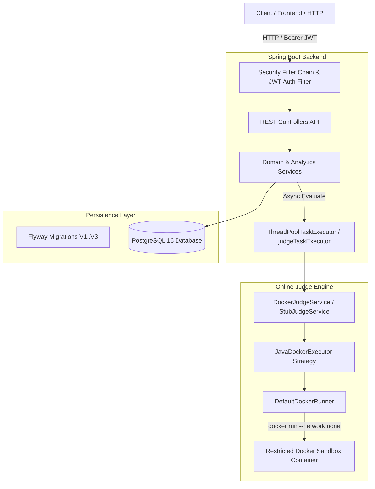
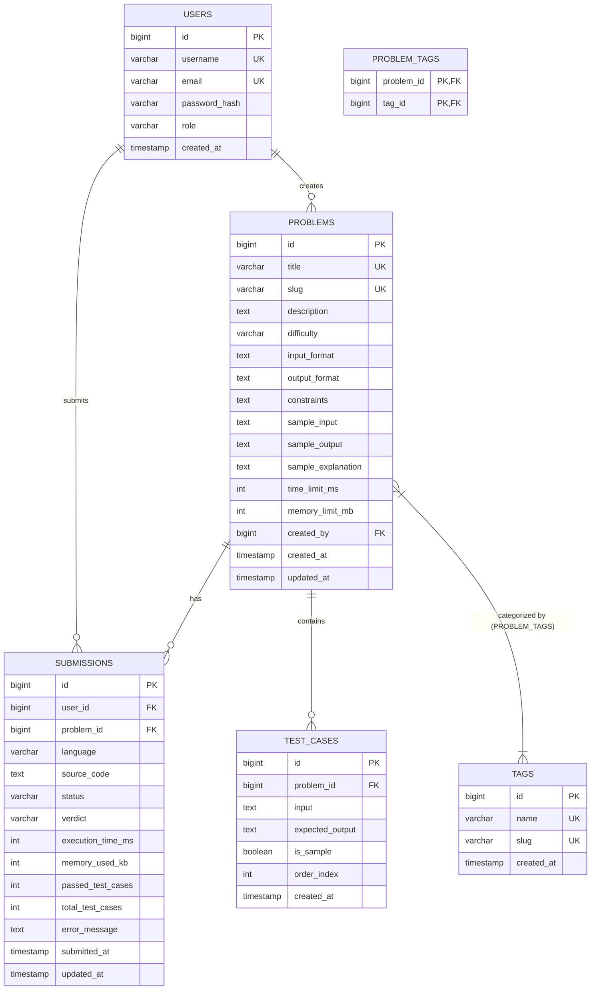

# Project Apricorn Architecture & Database Design

## Overview

Project Apricorn is a production-inspired online judge and competitive programming platform built with Spring Boot 3.3.5, Java 21 LTS, PostgreSQL 16, Flyway, JWT Authentication, and a restricted Docker execution engine.

## System Architecture Diagram

## Database Entity-Relationship (ER) Diagram

